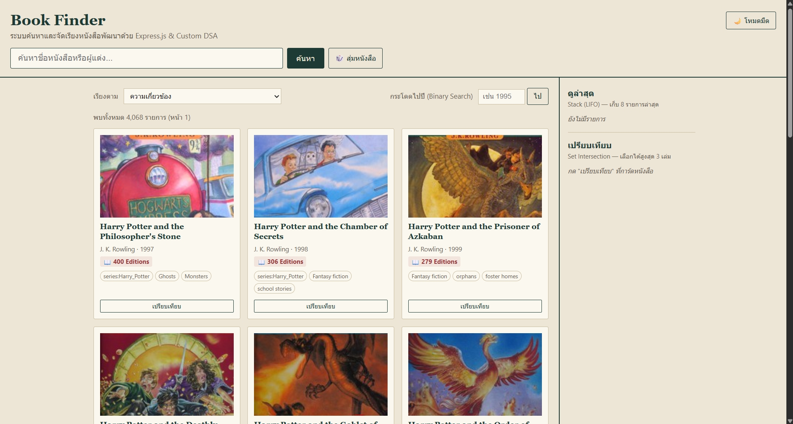
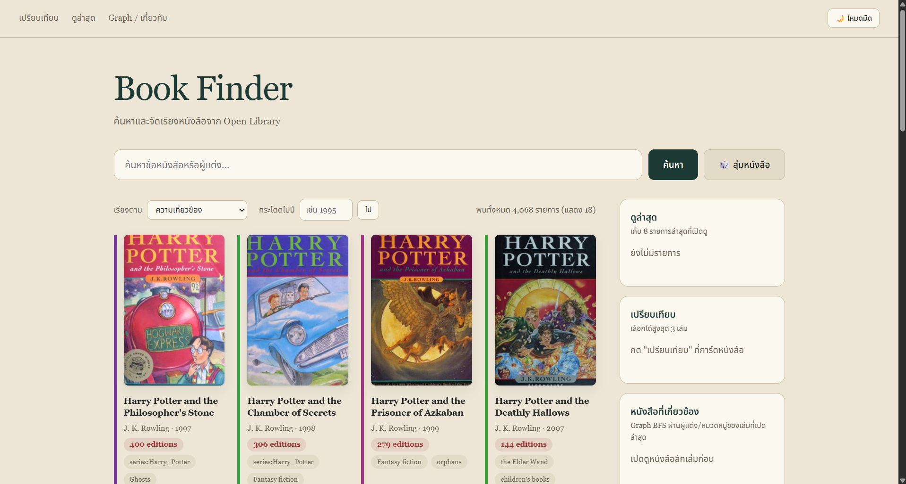
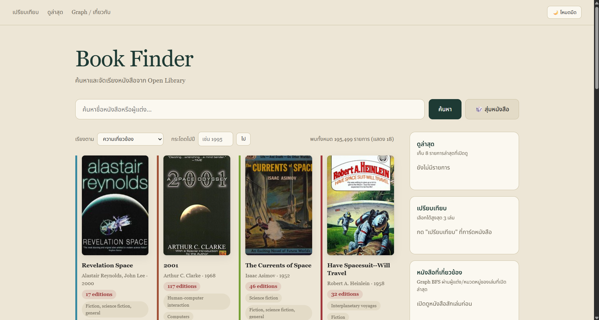
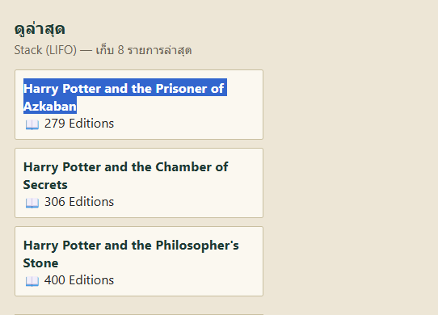
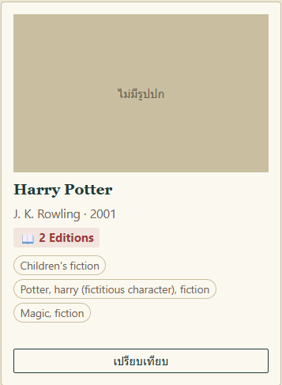
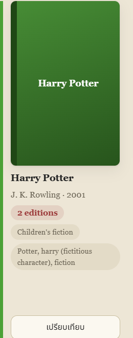
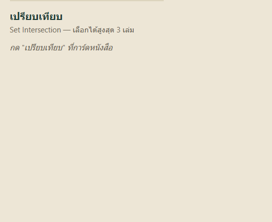
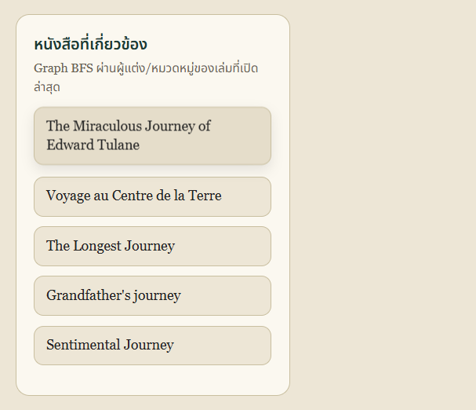

# Book Finder — React + Vite + Express

งานต่อยอด API วิชา 801201 · ใช้ [Open Library API](https://openlibrary.org/developers/api)
Frontend: React + Vite + React Router · Backend: Express (proxy + validate + cache)

## วิธีรัน

เปิด Terminal 2 หน้าต่าง

```bash
# หน้าต่าง 1: backend (http://localhost:3000)
cd backend
npm install
npm run dev

# หน้าต่าง 2: frontend (http://localhost:5173)
cd frontend
npm install
npm run dev
npm test      # ตรวจ graph.js และ dsa.js (12 เทสต์)
```

Vite ตั้ง proxy ให้ `/api` ไปที่ Express (`frontend/vite.config.js`) จึงเปิดใช้งานที่ `http://localhost:5173`

## โครงสร้าง

```
book-finder-express/
├── backend/            Express: /api/search, /api/work
│   └── server.js       validate, TTL cache (Custom Hash Table), warm-up, timeout, จัดการ error
├── frontend/           React + Vite
│   └── src/
│       ├── App.jsx            BrowserRouter, Routes, NavBar (สร้างจาก Graph)
│       ├── AppContext.jsx     state กลาง: ผลค้นหา, ดูล่าสุด, รายการเปรียบเทียบ
│       ├── graph.js           Graph (adjacency list) + BFS
│       ├── dsa.js             Trie, Merge Sort, Queue, Stack, Binary Search, Fisher–Yates
│       ├── api.js             เรียก Express (ไม่เรียก Open Library ตรง)
│       ├── components/        BookCard
│       └── pages/             Home, Book (หน้าต่างรายละเอียด), Compare, History, About, NotFound
└── public/             งานแรก (Express เสิร์ฟ HTML ตรง ๆ) เก็บไว้เป็นหลักฐาน Before
```

แผนภาพการทำงาน: `React (5173) → Vite proxy → Express (3000) → Open Library API`

## Component Tree และทิศทาง props

```
App                      state: dark
└─ BrowserRouter
   └─ AppProvider        state กลาง: query, books, total, status, hasMore, recent, compare
      ├─ NavBar          ← props จาก App: dark, toggle (callback ส่งกลับขึ้นไปสลับธีม)
      └─ main > AppRoutes
         ├─ HomePage     state: text, sug, sort, year, hl
         │   └─ BookCard ← props จาก HomePage: book, highlight
         ├─ ComparePage
         ├─ HistoryPage
         ├─ AboutPage    state: from, to
         ├─ BookPage     ← prop modal (true เมื่อเปิดจากการ์ด) state: work, err
         └─ NotFound
```

- ข้อมูลไหลลง: `App → NavBar` (props `dark`, `toggle`), `HomePage → BookCard` (props `book`, `highlight`)
- ข้อมูลที่หลายหน้าใช้ร่วมกัน ยกไปไว้ที่ `AppProvider` (Context) แล้วหน้าลูกเรียกฟังก์ชันกลับขึ้นไปแก้ state: `run`, `more`, `view`, `toggleCompare`
- BookCard กด "เปรียบเทียบ" เรียก `toggleCompare` ใน Context แล้ว `compare` เปลี่ยน แผงด้านขวาของ HomePage และหน้า ComparePage อ่าน `compare` ชุดเดียวกันจาก Context จึงแสดงข้อมูลตรงกัน

## 8.1 ตารางส่วนร่วม

| ชื่อ-สกุล | รหัสนักศึกษา | ชิ้นงานที่รับผิดชอบ (ไฟล์ / component / route / DSA) | ช่วงที่นำเสนอในคลิป |
|---|---|---|---|
| สิรวิชญ์ แสงจันทร์ | 681310411 | พัฒนาร่วมกันทุกส่วน · รับผิดชอบอธิบาย: `backend/server.js` (validate, Hash Table cache, warm-up), `graph.js`, NavBar ใน `App.jsx`, `AboutPage.jsx`, `ComparePage.jsx`, `dsa.js` | ช่วงที่ 1, 4 (Graph.js), 5, 6 |
| ภัคจิรา อินชูใจ | 681310788 | พัฒนาร่วมกันทุกส่วน · รับผิดชอบอธิบาย: `HomePage.jsx`, `BookCard.jsx`, `BookPage.jsx`, `HistoryPage.jsx`, `AppContext.jsx`, `index.css` | ช่วงที่ 2, 3, 4 (useState, useEffect, Component Tree) |

> หมายเหตุ: ทั้งสองคนพัฒนาร่วมกันบนเครื่องของสิรวิชญ์ ประวัติ commit จึงอยู่ในบัญชี `sirawit` คอลัมน์ "ชิ้นงานที่รับผิดชอบ" ระบุส่วนที่แต่ละคนรับผิดชอบอธิบายในคลิป

## 8.2 ข้อแนะนำจากงานแรก → สิ่งที่แก้

| ข้อแนะนำจากงานแรก | สิ่งที่แก้ในงานนี้ | หลักฐาน Before / After |
|---|---|---|
| หน้าแรกโหลด Harry Potter ตายตัว ให้เปลี่ยนเป็นสุ่มหนังสือ | หน้าแรกสุ่มหมวดด้วย Fisher–Yates ตอนเปิด และปุ่ม 🎲 สุ่มหมวดใหม่ (ไม่ซ้ำหมวดเดิม) พร้อมแสดงรายการทั้งหมด (`HomePage.jsx`) | Before:  · After:   (กดสุ่ม 2 ครั้งได้คนละหมวด) |
| คลิกดูหนังสือจาก "ดูล่าสุด" (Stack) ให้เหมือนคลิกจากการ์ดปกติ | ทั้งการ์ด, แผงดูล่าสุด และหน้า History ใช้ `<Link to="/book/:id" state={{ background }}>` เปิดหน้าต่างรายละเอียด (`BookPage`) แบบเดียวกัน | Before:  · After:  |
| ปรับ interface ให้สวยขึ้น | ออกแบบใหม่แบบ minimal    (สีตามสไลด์งานแรก, ฟอนต์ STIX Two Text ลาย Times สำหรับอังกฤษ + Noto Sans Thai สำหรับไทย, การ์ดเน้นปก, โหมดมืด, การ์ดโครงร่างตอนโหลด, หน้าต่างรายละเอียดมีปุ่มปิด) | Before:  · After:  |
| (เพิ่มเอง) การ์ดที่ไม่มีปกขึ้นกล่องเทา "ไม่มีปก" ดูโล่ง | สร้างสีจากชื่อเรื่องด้วย hash `hash * 31 + charCode` (สูตรเดียวกับ Hash Table ฝั่ง backend) ได้กล่องสีพร้อมชื่อเรื่องและแถบสันปกด้านซ้าย ชื่อเดียวกันได้สีเดิมทุกครั้ง (`BookCard.jsx`, `index.css`) | Before:  · After:  |
| (เพิ่มเอง) หน้าหลักไม่มีทางไปหนังสือที่เกี่ยวข้องกัน | เพิ่มแผง "หนังสือที่เกี่ยวข้อง" ใช้ `relatedBooks` (Graph BFS ผ่านผู้แต่ง/หมวดหมู่ ไม่เกิน 2 ชั้น) จากเล่มที่เปิดดูล่าสุด กดชื่อแล้วเปิดหน้าต่างรายละเอียดเหมือนแผงอื่น (`graph.js`, `HomePage.jsx`) | Before:  · After:  |
| (เพิ่มเอง) เปลี่ยนหน้าผลลัพธ์ไม่ได้ และชื่อในแผงเปรียบเทียบคลิกไม่ได้ | เพิ่มปุ่ม ก่อนหน้า / ถัดไป พร้อมแถบ "หน้า X / N" และปุ่ม "โหลดเพิ่มในหน้านี้" (Queue ของ offset) ส่วนชื่อหนังสือในแผงเปรียบเทียบและหน้า /compare คลิกเปิดหน้าต่างรายละเอียดได้ (`AppContext.jsx`, `HomePage.jsx`, `ComparePage.jsx`) | Before:  · After:  |

## 8.3 ตาราง useState

| ชื่อ state | เก็บข้อมูลอะไร | อยู่ใน component | เปลี่ยนค่าเมื่อใด / โดยใคร | ทำไมต้องเป็น state |
|---|---|---|---|---|
| `dark` | โหมดมืด/สว่าง | `App` | กดปุ่มสลับธีมใน NavBar | เปลี่ยนแล้วต้องวาดใหม่ และเป็น dependency ของ `useEffect` |
| `query` | คำค้นล่าสุดที่ส่งไป Express | `AppProvider` (Context) | `run(q)` ตอนค้นหา/สุ่ม | หลายส่วนใช้ร่วมกัน (HomePage แสดงในช่อง, `more()` ใช้ค้นต่อ, ปุ่มสุ่มใช้เลี่ยงหมวดเดิม) |
| `books` | รายการหนังสือผลค้นหา | `AppProvider` | `run` (ตั้งใหม่), `more` (ต่อท้าย) | HomePage และ ComparePage ใช้ร่วมกัน และเปลี่ยนแล้วต้องวาดการ์ดใหม่ |
| `total` | จำนวนผลทั้งหมดจาก API | `AppProvider` | `run` หลังได้ผลจาก Express | แสดงบนหน้าจอ ค่ามาจาก API คำนวณเองไม่ได้ |
| `status` | `idle / loading / ready / error` | `AppProvider` | `run`, `more` ตามผลเรียก API | ควบคุม loading (การ์ดโครงร่าง) / empty / error (ปุ่มลองใหม่) / success |
| `hasMore` | ยังมีหน้าถัดไปให้โหลดไหม | `AppProvider` | `run`, `more` | ซ่อน/แสดงปุ่ม "โหลดเพิ่ม" (คิว offset เก็บใน `useRef` จึงต้องมี state นี้คู่กันเพื่อสั่งวาดใหม่) |
| `recent` | Stack หนังสือที่ดูล่าสุด (สูงสุด 8) | `AppProvider` | `view(book)` ตอนเปิดหนังสือ | HomePage, BookPage, HistoryPage ใช้ร่วมกัน |
| `compare` | หนังสือที่เลือกเปรียบเทียบ (สูงสุด 3) | `AppProvider` | `toggleCompare(book)` | BookCard (ปุ่ม), HomePage (แผงด้านขวา) และ ComparePage ใช้ร่วมกัน จึงยกขึ้นไปไว้ที่ Context |
| `text` | ข้อความในช่องค้นหา | `HomePage` | พิมพ์ในช่อง / เลือกคำแนะนำ | ช่อง input แบบ controlled ใช้แค่หน้า Home |
| `sug` | รายการคำแนะนำจาก Trie | `HomePage` | `onType` เมื่อพิมพ์ ≥ 2 ตัวอักษร | เปลี่ยนแล้วต้องแสดงกล่องคำแนะนำ |
| `sort` | วิธีเรียงผลลัพธ์ | `HomePage` | เลือกจาก dropdown / `jump` | เป็น input ของ `useMemo` ที่เรียงด้วย Merge Sort |
| `year` | ปีที่พิมพ์ในช่องกระโดด | `HomePage` | พิมพ์ในช่องปี | input แบบ controlled |
| `hl` | หนังสือที่ถูกไฮไลต์ (ผลจาก Binary Search) | `HomePage` | `jump` ตั้งค่า แล้วล้างใน 2.2 วินาที | ควบคุมไฮไลต์ และเป็น dependency ของ effect เลื่อนจอ |
| `work` | รายละเอียดหนังสือรายเล่มจาก Express | `BookPage` | `getWork(id)` สำเร็จ | ได้ค่าแบบ async ต้องวาดใหม่ตอนข้อมูลมา |
| `err` | โหลดรายละเอียดล้มเหลวไหม | `BookPage` | `.catch` ของ `getWork` | แสดงข้อความ error |
| `from`, `to` | หน้าเริ่มต้น/ปลายทางที่เลือกตรวจ BFS | `AboutPage` | เลือกจาก dropdown | เปลี่ยนแล้วต้องคำนวณ `canReach` ใหม่ |

| `page` | หน้าแรกของผลที่กำลังแสดง (เริ่มที่ 1) | `AppProvider` | `run` ตั้งเป็น 1, ปุ่ม "ก่อนหน้า / ถัดไป" | ใช้คำนวณ offset ที่ขอจาก Express และแสดงในแถบ "หน้า X / N" เปลี่ยนแล้วต้องวาดใหม่ |
| `lastPage` | หน้าสุดท้ายที่โหลดต่อท้ายแล้ว | `AppProvider` | `run` ตั้งเท่า `page`, `more` เพิ่มทีละ 1 | แสดงช่วงเป็น "หน้า 1–2 / 50" และกำหนดว่าปุ่ม "ถัดไป" ต้องไปหน้าไหน |
| `pageCount` | จำนวนหน้าทั้งหมด | `AppProvider` | `run` หลังได้ `total` จาก API | ค่ามาจาก API คำนวณจากฝั่ง client เองไม่ได้ และใช้ปิดปุ่ม "ถัดไป" ที่หน้าสุดท้าย |


**ค่าที่เก็บใน `useRef` (เปลี่ยนแล้วไม่ต้องวาดหน้าจอใหม่):** `trie` (Trie สำหรับคำแนะนำ), `index` (Map key → หนังสือ), `pages` (Queue ของ offset), `reqId` (เลขคำขอล่าสุดไว้ทิ้งผลค้นหาที่ล้าสมัย)

**ค่าที่ไม่เก็บเป็น state เพราะคำนวณจาก state/props อื่นได้:** `sorted` (`useMemo` จาก `books` + `sort`), `shared`, `graph` และ `path` ใน `ComparePage` (คำนวณจาก `compare`/`books`), `picked` ใน `BookCard` (จาก `compare`), `current` และ `links` ใน `NavBar` (จาก URL + `pageGraph`), `orphans`/`deadEnds` ใน `AboutPage` รายการหนังสือที่เกี่ยวข้อง (`related`) ก็เป็นค่าที่ไม่เก็บเป็น state เช่นกัน เพราะคำนวณได้จากข้อมูลที่มีอยู่แล้ว คือเล่มที่เปิดดูล่าสุด (`recent[0]`) กับรายการหนังสือที่โหลดอยู่ (`books`) โดยใช้ `useMemo` สร้างกราฟด้วย `buildBookGraph` แล้วเรียก `relatedBooks` (BFS) ใหม่เมื่อสองค่านี้เปลี่ยน การไม่เก็บซ้ำเป็น state ช่วยให้ข้อมูลไม่ขัดแย้งกันและไม่ต้องเขียนโค้ดอัปเดตเพิ่ม

รายการหนังสือที่เกี่ยวข้อง (`related`) ก็เป็นค่าที่ไม่เก็บเป็น state เช่นกัน เพราะคำนวณได้จากข้อมูลที่มีอยู่แล้ว คือเล่มที่เปิดดูล่าสุด (`recent[0]`) กับรายการหนังสือที่โหลดอยู่ (`books`) โดยใช้ `useMemo` สร้างกราฟด้วย `buildBookGraph` แล้วเรียก `relatedBooks` (BFS) ใหม่เมื่อสองค่านี้เปลี่ยน การไม่เก็บซ้ำเป็น state ช่วยให้ข้อมูลไม่ขัดแย้งกันและไม่ต้องเขียนโค้ดอัปเดตเพิ่ม

## 8.4 ตาราง useEffect

| component | effect ทำอะไร | dependency array | ทำงานตอนไหน |
|---|---|---|---|
| `App` | ใส่/เอา class `dark` ที่ `<body>` และบันทึกธีมลง `localStorage` | `[dark]` | ตอนเปิดแอป และทุกครั้งที่กดสลับธีม |
| `HomePage` #1 | ถ้า `status === 'idle'` ให้ค้นหาด้วยหมวดสุ่ม (`shuffle(SEEDS)[0]`) ผ่าน Express | `[]` | ครั้งเดียวตอน mount (เงื่อนไข `idle` กันโหลดซ้ำเมื่อกลับมาหน้าแรก) |
| `HomePage` #2 | sync ข้อความในช่องค้นหาให้ตรงกับ `query` ใน Context | `[query]` | เมื่อ `query` เปลี่ยน (เช่น กดสุ่ม หรือเลือกคำแนะนำ) |
| `HomePage` #3 | เลื่อนจอไปที่การ์ดที่ไฮไลต์ | `[hl]` | เมื่อกด "ไป" ปีแล้ว `hl` เปลี่ยน |
| `BookPage` #1 | ล้าง `work`/`err`, บันทึกเข้า Stack ดูล่าสุด, เรียก `getWork(id)` จาก Express | `[id]` | ตอนเปิดหนังสือ และเมื่อ `id` ใน URL เปลี่ยน |
| `BookPage` #2 | (เฉพาะโหมดหน้าต่าง) ฟังปุ่ม Esc เพื่อปิด และล็อกการเลื่อนของหน้าด้านหลัง แล้วคืนค่าตอนปิด (cleanup) | `[modal]` | ตอนหน้าต่างเปิด และ cleanup ตอนปิด |

`AppContext` ไม่มี `useEffect` การเรียก API เกิดจาก event handler (`run`, `more`) ที่ผู้ใช้กด หรือจาก effect ของหน้าที่เรียก

**ป้องกัน loop / เรียก API ซ้ำ:**
- effect ที่เรียก API มี dependency เฉพาะค่าที่ตั้งใจ (`[]` และ `[id]`) ไม่ใส่ state ที่ effect เปลี่ยนเอง (`books`, `status`, `work`) จึงไม่วนซ้ำ
- `reqId` (useRef) ใช้เลขคำขอล่าสุด ถ้าผู้ใช้ค้นใหม่ระหว่างรอ ผลของคำค้นเก่าจะถูกทิ้ง ไม่มาทับผลใหม่
- Express มี cache จึงไม่ยิง Open Library ซ้ำเมื่อคำค้นเดิม

## Graph.js เชื่อมเมนูกับหน้า

- `pageGraph` เป็น directed adjacency list: node = หน้า (home, compare, history, about), edge = `<Link>` บน NavBar
- `NavBar` อ่าน `pageGraph[current]` แล้ว map เป็น `<Link>` ไม่มีรายการเมนูตายตัว
- `canReach` (BFS: queue + visited Set, O(V+E)) และ `checkGraph()` ตรวจหน้า orphan และทางตัน แสดงผลในหน้า "Graph / เกี่ยวกับ"
- Graph ที่สอง (undirected) เชื่อม หนังสือ–ผู้แต่ง–หมวดหมู่ ใช้ BFS หาเส้นทางสั้นสุดระหว่างหนังสือสองเล่มในหน้า Compare

## Express ทำหน้าที่อะไร (backend/server.js)

| หน้าที่ | รายละเอียด |
|---|---|
| Proxy | React ไม่เรียก Open Library ตรง ผ่าน `/api/search` และ `/api/work` |
| Validate | จำกัดความยาวคำค้น (≤ 100), `page` 1–50, `limit` 1–40, `key` ต้องตรง `/works/OL...W` ไม่ถูกต้องตอบ 400 |
| Cache | เก็บผลใน Custom Hash Table (Array of buckets + chaining) พร้อม TTL 1 ชั่วโมง |
| Warm-up | ตอนเปิดเซิร์ฟเวอร์โหลด 10 หมวดที่ใช้สุ่มเก็บใน cache ล่วงหน้า และโหลดทับใหม่ทุก 50 นาที ให้ปุ่มสุ่มตอบทันที |
| Timeout + Error | ตัดการรอ Open Library ที่ 15 วินาที ตอบ 502 เป็น JSON ระบบไม่ล่ม และหน้าเว็บมีปุ่ม "ลองใหม่" |

## DSA ที่ใช้กับข้อมูลจริง

| DSA | ฝั่ง | ใช้ทำอะไร | Big-O |
|---|---|---|---|
| Custom Hash Table | Express | cache ผลค้นหา/รายละเอียดตาม key (TTL + warm-up) | get/set เฉลี่ย O(1) |
| Graph + BFS | React | NavBar, ตรวจหน้า orphan/ทางตัน, หาเส้นทางระหว่างหนังสือ | O(V+E) |
| Trie | React | คำแนะนำชื่อหนังสือตอนพิมพ์ | O(L) ต่อคำ |
| Merge Sort | React | เรียงผลตามปี/จำนวน edition/ชื่อ | O(n log n) |
| Binary Search | React | หาเล่มแรกที่ปี ≥ ปีที่ระบุ (lower bound) ในรายการที่เรียงแล้ว แล้วกระโดดไปที่การ์ดนั้น | O(log n) |
| Queue | React | คิว offset ของ "โหลดเพิ่ม" | O(1) enqueue |
| Stack (จำกัดขนาด) | React | ดูล่าสุด 8 รายการ | O(n) ต่อ push (n ≤ 8) |
| Fisher–Yates | React | สุ่มหมวดหน้าแรกและปุ่มสุ่ม | O(n) |
| Set Intersection | React | หมวดหมู่ร่วมของหนังสือที่เลือกเปรียบเทียบ | O(n·k) |

**ตัวเลขเทียบก่อน-หลัง cache (วัดจริงจาก `/api/search`):**

| คำค้น | สถานะ | เวลา (ms) |
|---|---|---|
| `harry` | ครั้งแรก `cached:false` (ต้องไปถาม Open Library) | 7373 |
| `harry` | ค้นซ้ำ `cached:true` (อ่านจาก Hash Table) | 0 (ต่ำกว่า 1 ms) |
| `magic` | ครั้งแรกที่ผู้ใช้ค้น แต่ `cached:true` เพราะ warm-up โหลดไว้ล่วงหน้า | 0 (ต่ำกว่า 1 ms) |

สรุป: cache ลดเวลาตอบจากประมาณ 7.4 วินาทีเหลือต่ำกว่า 1 มิลลิวินาที และ warm-up ทำให้หมวดที่ปุ่มสุ่มใช้ (เช่น `magic`) เร็วตั้งแต่ครั้งแรก

## ลิงก์

- YouTube (Unlisted): (ใส่ลิงก์)
- Vercel (ไม่บังคับ): (ใส่ลิงก์ถ้ามี)